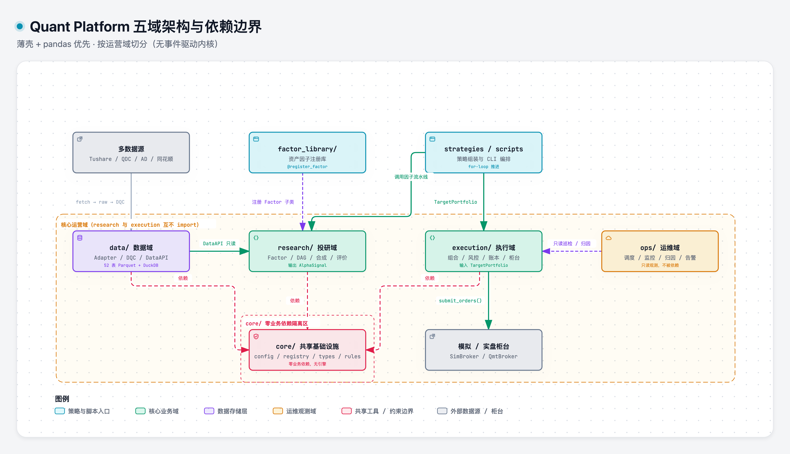
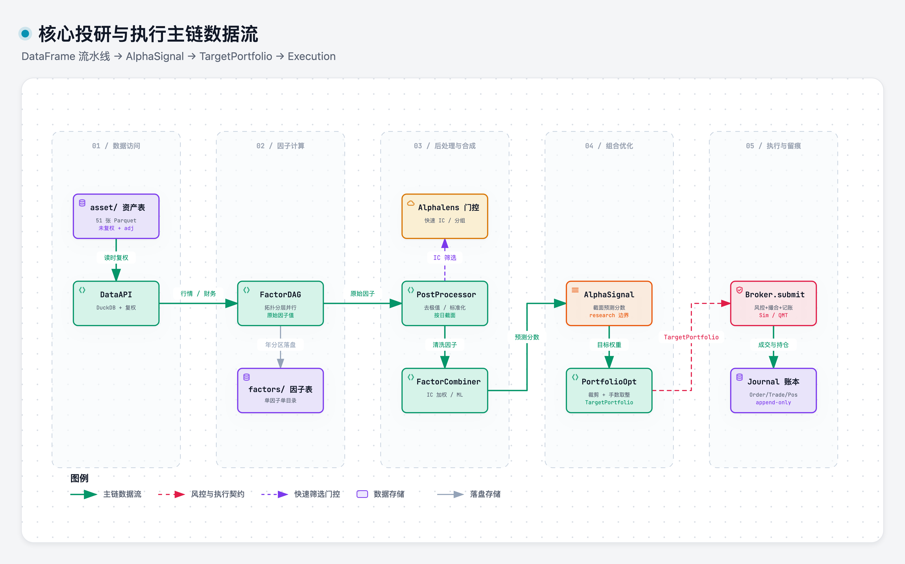
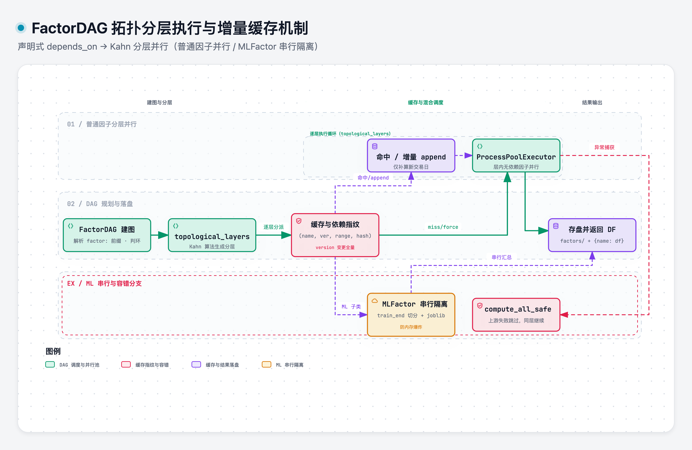

# Quant Platform 架构总纲

> 状态：V1实施完成，验收迁移中
> 
> 最后更新：2026-11-14

这份文档是平台架构的**唯一权威总纲**：范式、边界、跨域契约、选型定稿。各域细节见 `design/<域>/` 下的模块文档（40 份模块设计 + [data/asset/](data/asset/README.md) 8 份分域表字典，完整索引见 [design/README.md](README.md)）；现行代码放置规则见 [PROJECT_STRUCTURE.md](../PROJECT_STRUCTURE.md)。

---

## 1. 总纲

**薄壳 + pandas 优先，对齐头部机构的分层范式，不照搬其重引擎实现。**

重构目标：**架构范式对齐**。研究迭代速度、工程可演进性、实盘落地能力是范式带来的结果。

## 2. 五域骨架

系统按**运营域**切分，不按研究流水线阶段切分。

```text
core/         共享工具（config / registry / logging / types / asset_rules）
data/         数据接入与存储（SourceAdapter / DQC / 存储 schema / DataAPI）
research/     投研（Factor / DAG / 后处理 / 合成 / 评价 / alphaType）
execution/    执行（组合构建 / 订单 / 风控 / 费用 / 账本 / 柜台）
ops/          运维（调度 / 监控 / 归因 / 告警）
```

### 2.1 依赖方向



> [打开 Archify 交互图](.diagrams/01-five-domain-architecture.html)

**硬规则**：`core/` 不 import 任何其他域；`research/` 与 `execution/` 互不依赖；`ops/` 只读观测，不被依赖。

### 2.2 core/ 是共享工具，不是引擎

core/'只包含跨域共享工具:`config.py`、`registry.py`、`logging.py'、`types.py'、`asset_rules.py'
**无引擎、无事件循环、无时间模型。**时间推进由回测 foor-Loop承担(S3.1),数据访问由 data/'域的 DataAPI承担

## 3. 主链契约

### 3.1 时间推进：for-loop

月频/日频下，时间推进就是一个循环：

```python
for date in rebalance_dates():
    ...
```

不采用事件驱动框架。

策略主循环是 `run()` 里的 **顺序调用**（行情 -> 信号 -> 组合 -> 风控 -> 执行），组件通过构造函数注入。详见 [core/registry.md](core/registry.md)。

### 3.2 三步主链



> [打开 Archify 交互图](.diagrams/02-main-pipeline-dataflow.html)

- AlphaSignal：截面分数 DataFrame ->  [research/alpha_signal.md](research/alpha_signal.md)
- Portfolio：目标持仓构建 ->  [execution/portfolio_construction.md](execution/portfolio_construction.md)
- Execution: 风控 + 撮合 + 记账 -> [execution/broker.md](execution/broker.md)

**接口边界在函数，不在产品**。执行域只认目标持仓（TargetPortfolio），订单由执行域自己算。薄壳**是"翻译官"**，把各框架方言翻译成薄壳 dataclass，不替代框架做它擅长的事。

### 3.3 因子组织：Factor ABC + FactorDAG



> [打开 Archify 交互图](.diagrams/09-factor-dag-runtime.html)

静态拓扑DAG，不用时间订阅————离线计算无实时事件流、依赖关系静态、DataFrame天然批量。详见[research/factor_interface.md](research/factor_interface.md)和[research/factor_runtime.md](research/factor_runtime.md)。

alphalens是回测前**筛选层门控**（快速 IC/分组，不建模成本/滑点/涨跌停），不是验证层；与正式回测结论矛盾时**以回测为准**。

## 4. 选型定稿表

| 维度 | 选型 | 否决项 | 详情 |
|---|---|---|---|
| 回测引擎 | pandas自研 SimBroker/QmtBroker | backtrader/vnpy（事件驱动不需要）；VectorBT 留 V2 备选 | [execution/broker.md](execution/broker.md) |
| 存储 | Parquet + DuckDB 持久化 `catalog.duckdb`（`asset/` 51 表与 `factors/` 1 表平级，无 `ext/` 顶层） | ClickHouse、DuckDB 纯内存模式、混合目录 `cn_reference/` | [data/storage_schema.md](data/storage_schema.md)、[data/asset/](data/asset/README.md) |
| 数据接入 | SourceAdapter 四方法 + watermark | - | [data/source_adapter.md](data/source_adapter.md) |
| 因子评价 | alphalens-reloaded 0.4.6 | alphalens 原版（不维护） | [research/factor_evaluation.md](research/factor_evaluation.md) |
| 配置 | TOML 三层 + .env + git | YAML（on→True 陷阱）；配置中心（单机不需要） | [core/config.md](core/config.md) |
| 日志 | Python logging + JSONL | ELK/Loki、分布式追踪（单进程 grep/jq 足够） | [core/logging.md](core/logging.md) |
| 测试 | pytest 三层 + hypothesis + 黄金样本 | - | [core/testing.md](core/testing.md) |
| 多资产 | ASSET_RULES配置区分 | - | [core/asset_rules.md](core/asset_rules.md) |
| 调度 | APScheduler + job_runs.jsonl | crontab（无失败重试/无状态记录）| [ops/scheduler.md](ops/scheduler.md) |

## 5. 跨域契约一览

各契约的字段级定义在对应模块文档：

| 契约 | 形态 | 文档 |
|---|---|---|
| 行情长表 `load_bars` | date/ticker/OHLCV/amount/[adjfactor] | [data/data_api.md](data/data_api.md) |
| AlphaSignal | 截面分数 DataFrame | [research/alpha_signal.md](research/alpha_signal.md) |
| TargetPortfolio | ticker → 目标权重/金额 | [execution/portfolio_construction.md](execution/portfolio_construction.md) |
| 账本 dataclass | Order / Trade / Position / Account / JournalEntry | [execution/ledger.md](execution/ledger.md) |
| config_snapshot | `path@hash` 钉进运行记录 | [core/config.md](core/config.md)、[core/logging.md](core/logging.md) |
| 运行记录 | logs/runs/ 三 schema（jobs / backtests / live） | [core/logging.md](core/logging.md) |
| 资产规则 | ASSET_RULES 查表 | [core/asset_rules.md](core/asset_rules.md) |

## 6. 黄金样本与验证

**平台级黄金样本 = 等权 top-5 ETF 动量**。五步验证法：手算 Excel → pandas → SimBroker 全链路 → 扣费对拍 → 五年基线落盘。详见 [core/testing.md](core/testing.md)。


## 7. 迁移阶段与红线

| 阶段 | 资产 | 备注 |
|---|---|---|
| V1 | 股票 + ETF | 主战场（A 股特殊机制：T+1 / 涨跌停 / 印花税 ETF 免） |
| V2 | 可转债 | T+0、无印花税——规则表加一行 |
| V3 | 期货 | 保证金 + 逐日盯市——新账本，不复用 SimAccount |
| V4+ | 期权 | 不推荐散户，最后做 |

实施红线：

1. **不要写事件驱动内核**。for-loop 就是时间模型。
2. **不要给因子发明事件订阅机制**。Factor ABC + FactorDAG 即可。
3. **不要让 `core/` import 任何域**。它谁都不依赖。
4. **不要让回测和实盘走不同代码路径**。差异只注入在 Broker 实现（Sim/Qmt）。
5. **不要把一次性实验放进注册表**。
6. **`.env` 不入 git、不打印**

## 8. 文档地图

- 设计文档分域索引见 [design/README.md](README.md)
- 资产表逐字段字典见 [data/asset/README.md](data/asset/README.md)
- 仓库文档总目录见 [docs/README.md](../README.md)
- 现行代码放置规则见 [PROJECT_STRUCTURE.md](../PROJECT_STRUCTURE.md)
