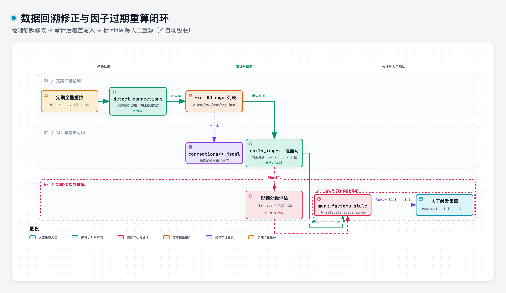

# data_revision

> 域：data · 对应代码 [data/data_revision.py](../../../data/data_revision.py)

## 职责与边界

数据回溯修正的全流程：**检测 → 应用 → 影响传播**。数据源会静默覆盖历史值且不给修正标记，平台必须自己发现订正、安全地写回，并让下游知道哪些结果已过期。

- **检测**：每周日 02:00 全量重拉近 30 交易日，与本地逐行比对；季度全量近 1 年兜底。
- **应用**：覆盖写入 + 修正日志审计，走完整 `daily_ingest` 流水线。
- **影响传播**：severity 分级 + 因子 stale 标记，**不自动重跑下游**，人工决定。

边界：不做数据版本化（历史版本不保留，只留修正日志）；不自动级联重算因子/回测。

### 回溯修正与过期传播流程



> [打开 Archify 交互图](../.diagrams/08-data-revision-loop.html)

## 接口签名

```python
CORRECTION_TOLERANCES = {close: 0.01, volume: 100, amount: 1000, adjfactor: 1e-6}

@dataclass
class FieldChange:
    ticker: str; field: str
    old_value: float; new_value: float
    abs_diff: float; rel_diff: float

@dataclass
class CorrectionRecord:   # 写入 corrections/{asset}/{date}.jsonl
    asset_type: str; trade_date: date
    detected_at: datetime
    changes: list[FieldChange]

def detect_corrections(asset_type: str, lookback: int = 30) -> list[FieldChange]
def apply_corrections(changes: list[FieldChange]) -> list[CorrectionRecord]
def assess_correction_impact(record: CorrectionRecord) -> str   # LOW | MEDIUM | HIGH
def mark_factors_stale(record: CorrectionRecord) -> list[str]   # 受影响因子名
```

**severity 判定**：HIGH = adjfactor 变动；MEDIUM 价格相对差 >1%；LOW = 其余。只 MEDIUM+ 告警。


## 关键决策

| 决策 | 否决项 | 一句话理由 |
|---|---|---|
| 覆盖写入，不版本化 | 多版本共存 | 存储膨胀；平台永远用最新数据 |
| 修正日志 `corrections/{asset}/{date}.jsonl` append | 只覆盖不记录 | 审计与影响追溯需要 |
| 每周全量重拉近 30 交易日逐行比对 | 信源的修正标记 | 数据源静默覆盖，无修正通知 |
| 季度全量近 1 年兜底 | 只做周扫 | 覆盖长周期回溯修正 |
| 比对容差 `CORRECTION_TOLERANCES` 四字段 | 精确相等 | 源侧浮点/口径微差会噪音告警 |
| 修正走完整 daily_ingest 流水线 | 只改 Parquet 文件 | DQC/raw/watermark 都要同步更新 |
| 下游**不自动重跑**，标 stale 人工决定 | 自动级联重算 | 慢、影响小、级联深、需人工判断 |
| severity LOW/MEDIUM/HIGH，只 MEDIUM+ 告警 | 全部告警 | 噪音淹没真问题 |


## 实现要点

详见  [data/data_revision.py](../../../data/data_revision.py)

核心约定:
- 检测:重拉→与本地逐行比对→超容差的字段变动记入FieldChange
- 应用:先追加修正日志(corrections/下jsonl),再走完整 daily_ingest流水线覆盖写
- 影响传播:assess_correction_impact按 adjfactor>价格>其余分级;mark_factors_stale按depends_on反查受影响因子,写入 metadata.json的 stale_since
- 不自动重算:factorlist--stale查看>recompute-stale人工触发→clear-stale 确认清除
