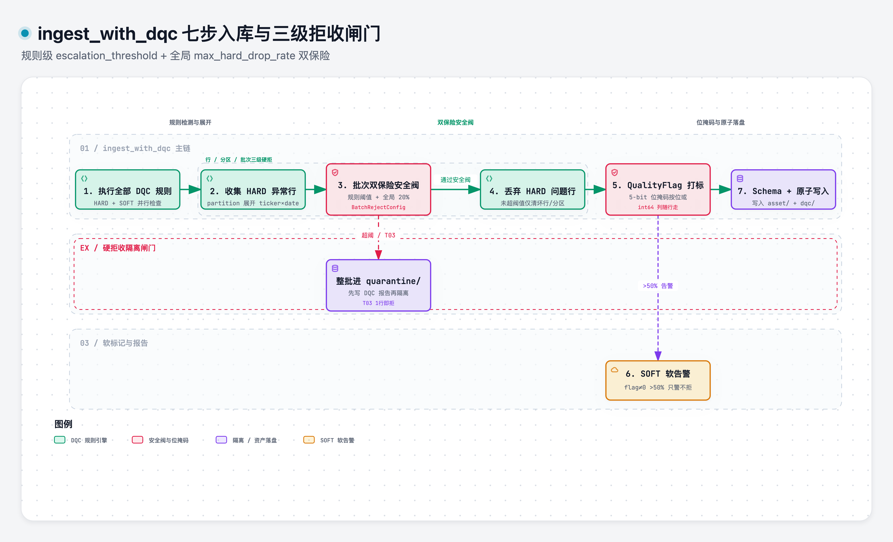

# dqc_severity

> 域：data · 对应代码 [data/dqc/severity.py](../../../data/dqc/severity.py)

## 职责与边界

DQC 检出问题后的**处置判定**：硬/软边界怎么切、硬拒的粒度多大、行级问题如何标记、批次何时整拒。[dqc_rules.md](dqc_rules.md) 定「查什么、多严」，本模块定「**查出来怎么办**」。

核心机制四件：
- `DQCSeverityConfig`（每规则 row_action + 升级阈值）
- 三级硬拒粒度（行/分区/批次）
- `QualityFlag` int64 位掩码（行级问题标签）
- `BatchRejectConfig` 全局安全阀

### 七步入库与三级拒收闸门



> [打开 Archify 交互图](../.diagrams/07-dqc-seven-step-gate.html)

## 接口签名

```python
@dataclass
class DQCSeverityConfig:
    row_action: str                   # "drop" | "flag" | "pass"
    escalation_threshold: float | None  # 异常占比超此值 → 硬拒整批；flag 类恒 None
                                         # partition 规则比的是展开后的 drop 率（issue #63）

@dataclass
class BatchRejectConfig:
    max_hard_drop_rate: float = 0.20  # HARD drop 行占比 >20% → 拒收整批
    soft_alarm_rate: float = 0.50     # quality_flag≠0 行占比 >50% → 告警（不拒收）

class QualityFlag:                    # int64 位掩码，bit ↔ SOFT 规则
    CLEAN = 0
    C02_LOW_COVER     = 1 << 0   # 覆盖率不足
    C05_HIGH_NULL     = 1 << 1   # 空值率偏高
    L04_LIMIT_OUT     = 1 << 2   # 超涨跌停
    L07_ADJFACTOR_ABN = 1 << 3   # adjfactor 范围异常
    K01_OVERNIGHT_GAP = 1 << 4   # 隔夜跳空过大
    # bit5+ 预留扩展（新增 SOFT 规则顺次占位
def compute_quality_flag(df: pd.DataFrame, soft_results: list[CheckResult]) -> pd.Series: ...
def ingest_with_dqc(df, date, config) -> None: ...   # 七步入库（见实现要点）
```

下游消费（[data_api.md](data_api.md)）：**默认不过滤**，全量使用；`quality_flag` 作为 int64 列跟着数据走。DuckDB 位运算过滤（`quality_flag & 1 = 0` 去掉价格异常）。

### 7 场景判定

| 场景 | 判定 | 理由 |
|---|---|---|
| 主键重复 | 硬 – 丢弃后入库 | 去重是清洗不是告警 |
| 时间倒流 | 硬 – 拒收该分区 | 时间戳非单调 = 结构损坏 |
| 空值率 5% | 软 | 新上市/退市过渡、源偶尔缺失的正常波动 |
| 空值率 30% | 硬 – 拒收该批次 | 系统性故障，非个别缺失 |
| 价格异常（涨跌停外） | 软 + quality_flag | 除权、复牌、ST 摘帽等合法场景会触发 |
| 跨源不一致 | 软 + 告警 | 合理误差存在，硬拒频繁误杀 |
| 关键字段全空 | 硬 – 拒收该行 | 无信息量 |

## 关键决策

| 决策 | 否决项 | 一句话理由 |
|---|---|---|
| 边界**按规则分**（每规则自带 row_action + escalation） | 全局一刀切 | 同一资产内不同问题的故障等级不同 |
| 硬拒三级粒度：行级 drop / 分区级拒收 / 批次级拒收 | 只有批次级拒收 | 小问题不陪葬整批 |
| `quality_flag` = int64 位掩码，一列可叠加 | 枚举单标签 / 多列 bool / JSON | 一行可同时中多条 SOFT；DuckDB 位过滤快 |
| bit ↔ 规则取五位（C02/C05/L04/L07/K01） | 分段式（合法性 0–7/一致性 8–15/…）+ PRICE_OUTLIER 枚举名 | 五位与现行 SOFT 规则一一对应；分段式不采用，bit5+ 直接预留 |
| 下游**默认不过滤** | 默认只用干净行 | 异常值本身可能是信号；容忍度留给研究者 |
| 双保险：规则级 escalation + 全局 max_hard_drop_rate | 只有其一 | 前者防单规则大面积失败，后者防多规则各错一点合计一大片 |
| SOFT flag >50% 只告警不拒收 | 也拒收 | flag 是调查线索不是损坏证据 |
| T03 未来日期 1 行即整批拒收 | 同 5%/20% 阈值 | 时间戳损坏零容忍 |

处置规律：`flag` 规则全部 `escalation=None`（永远不升级）；`drop` 规则升级阈值按故障等级——数据损坏类（负价格/OHLC 错/格式错/adjfactor 异变）1%，结构性缺失类（市值/inf/多规则勾稽）5%，跨粒度不一致 K06–K08 10% 升告警（不丢行），大面积空值 C04 20%，未来日期 1 行整拒。

## 实现要点

详见 [data/dqc/severity.py](../../../data/dqc/severity.py)

七步入库(ingest_with_dqc):
1. 跑全部规则(HARD+SOFT)
2. 收集行级HARD drop行(partition规则展开到 ticker*date组)
3. 批次安全阀:(a)规则级escalation_threshold (b)全局max_hard_drop_rate
4. 丢问题行
5. compute_quality_flag打标(SOFT规则按位或合并)
6. 软告警(>50%行有标记时告警,不拒收)
7. schema校验+原子写入

核心约定:
- quality_flag与数据同行写 Parquet,位定义与 storage_schema.md 的 QualityFlag 同源
- 规则级escalation 用partition展开后的drop rate 检查，与全局阈门口径统一
- 被拒批次先写DQC报告再进quarantine,保证拒收事实有记录
