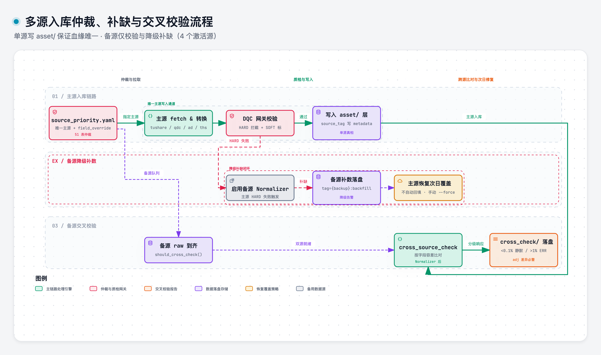

# ingestion

> 域：data · 对应代码 [data/ingestion.py](../../../data/ingestion.py) · 源能力画像 [config/source_capabilities.yaml](../../../config/source_capabilities.yaml)

## 职责与边界

多源入库的**仲裁与编排**：谁是主源、备源何时上场、两源数据怎么比、缺数怎么补。单条链路的拉取在 [source_adapter.md](source_adapter.md)，DQC 在 `dqc_*`，落盘在 [quarantine_raw.md](quarantine_raw.md) / `storage_*`；本模块回答「**多个源之间怎么协作**」。

核心原则一句话：**单源写入 asset 层、多源交叉校验**——备源只校验补缺，不混合写入。

### 多源仲裁与交叉校验流程



> [打开 Archify 交互图](../.diagrams/06-multi-source-ingestion.html)

## 接口签名

```yaml
# config/source_priority.yaml — 主源指定表（示例）
cn_stock_bars_daily:    {priority: [straightflush, qdc, amazingdata], field_override: {adjfactor: qdc}}
cn_stock_bars_minute:   {priority: [qdc, amazingdata]}
cn_stock_fundamental:   {priority: [qdc, straightflush], field_override: {total_market_cap: straightflush, float_market_cap: straightflush}}
cn_etf_bars_daily:      {priority: [straightflush, qdc, amazingdata], field_override: {adjfactor: qdc}}
```

```python
@dataclass
class MismatchDetail:   # 按字段聚合（非逐 ticker 明细）
    field: str
    mismatch_count: int; mismatch_rate: float; max_abs_diff: float
    sample_tickers: list[str]   # 前 5 个不一致的 ticker

@dataclass
class CrossCheckResult:
    table: str; trade_date: str
    primary_source: str; secondary_source: str
    total_rows: int; matched_rows: int
    mismatched_fields: dict[str, MismatchDetail]
    missing_in_primary: int; missing_in_secondary: int

def cross_source_check(df_a, df_b, table) -> CrossCheckResult: ...
def should_cross_check(...) -> bool:   # hook：主源入库完成 + 备源 raw 已到达
```

容差（按字段类）：price 0.01 绝对 / volume,amount 0.001 相对 / adjfactor 1e-6 / pe_pb 0.02 / default 0.001。

对比时机：**Normalizer 之后、两源都入库后**才比。

### 跨源校验节奏与响应

| 项 | 定稿 |
|---|---|
| 频率 | 日频每天；分钟频每周抽 1 天；reference 每次更新；factor 不做 |
| 结果落盘 | `cross_check/{table}/{date}.json`（明细）+ `summary.parquet` |
| <0.1% 不一致 | 静默记录 |
| 0.1–1% | WARNING |
| >1% | ERROR |
| adjfactor 不一致 | **始终告警** |

### 备源补数

允许，但严格标记：`source_tag = "{backup}:backfill"` 写入 Parquet **metadata**（不是数据列）。主源恢复后**次日覆盖**；不自动回填，手动 `--force`。

## 关键决策

| 决策 | 否决项 | 理由 |
|---|---|---|
| 单源写 asset，备源只校验/补缺 | 多源混合写入 | 血缘清晰，问题可追到源 |
| **不做自动主源选举** | 主源挂了自动切备源为主 | 静默换人是事故温床 |
| `source_priority.yaml` 按 table 索引 | 硬编码优先级 | 字段级覆盖 |
| `cn_stock_fundamental` 以 QDC 为主源 + SF 实时市值覆写 | SF 为主源仅覆写 `pe_ttm` | SF 仅提供最新估值快照，历史 `pe_lyr`/`pb`/`ps_ttm` 会引入前视偏差 |
| 跨源对比在 Normalizer 后 | raw 对比 | raw 列名口径不同 |
| 对比容差按字段类给 | 全局单一容差 | 价格/成交量/比率的误差量纲不同 |
| 分级响应 + adjfactor 永远告警 | 不一致即拒收 | 跨源合理误差存在，硬拒频繁误杀 |
| 备源补数写 metadata 不写数据列 | 加 source 列污染 schema | asset 层 schema 稳定，血缘走 Parquet metadata |

**必须规避的坑**：某数据源在 `suspend==1` 时把 `adjfactor` 写死为 1。**每个 SourceAdapter 的字段映射逻辑必须有测试覆盖**，重点边界：停牌、缺值、CA 事件。

## 实现要点

详见 [data/ingestion.py](../../../data/ingestion.py)

入库流程:
1. 主源fetch→DQC→写asset
2. 备源raw到达后交叉校验→落 `cross_check/` 结果并分级响应
3. 主源HARD失败+备源可用→fallback补数(带backfill标记+降级告警)

核心约定:
- field_override 里的字段从指定源取值替换(如 `adjfactor` 取 `qdc`、`cn_stock_fundamental` 实时市值取 `straightflush`)
- 新增数据源=Adapter + Normalizer + `source_priority.yaml` 加一行，能力边界同步记录至 [config/source_capabilities.yaml](../../../config/source_capabilities.yaml)
- `source_priority.yaml` 与 `source_capabilities.yaml` 存放于 `config/`（git 追踪）
- `TushareAdapter` 2000 积分扩展规划（`daily_basic` / `trade_cal` / `stock_basic` / `index_daily` / `fut_basic`）当前列为 TODO，见 [tushare_adapter.py](../../../data/adapters/tushare_adapter.py)

### 已打通多源校验的表与实测边界（2026-11-13 ~ 2026-11-16）

| 规范表 | 优先级（[source_priority.yaml](../../../config/source_priority.yaml)） | 多源校验状态 | 细节与已知问题 |
|---|---|---|---|
| [`cn_calendar`](asset/01-stock-core-and-status.md#1-cn_calendar交易日历) | `straightflush` → `qdc` → `amazingdata` | 已配置（`silent`，仅比 `trade_date` 交集窗口） | QDC 不支持日历跳过；AmazingData 返回整型 `YYYYMMDD` 需先转字符串解析，macOS 走 Docker 挂载拉取 |
| [`cn_stock_bars_daily`](asset/01-stock-core-and-status.md#3-cn_stock_bars_daily股票日线行情) | `straightflush` → `qdc` → `amazingdata` | 已配置（SF vs QDC / AD 均 `silent`） | `field_override: adjfactor=qdc`；Normalizer 显式强制浮点列转 `float64`；QDC 当日滞后返回空表时会触发回退 `amazingdata:backfill` |
| [`cn_etf_bars_daily`](asset/06-etf-and-fund.md#2-cn_etf_bars_dailyetf-独立日线行情) | `straightflush` → `qdc` → `amazingdata` | 已配置（AD `silent`；QDC `WARNING 0.17%`） | SF 零成交 `NaN` 由入库过滤（`<= 20%`）且交叉校验在 `volume==0` 等收盘时豁免；保留 QDC `tdx_mootdx` 小额 ETF 整百截断 `WARNING` |
| [`cn_stock_index_bars_daily`](asset/02-stock-index-and-board.md#2-cn_stock_index_bars_daily指数与板块日线行情) | `straightflush` → `qdc` → `amazingdata` | 已配置（QDC `WARNING 0.36%`；AD `ERROR 2.89%–3.24%`） | SF 与 QDC 在 `399001.SZ`/`399006.SZ` 同为全市场量额且 QDC 缺 `.BJ` 指数与盘后时效，暂维持 SF 主源；AD 按成份股计算量额及债券指数口径差异触发 `ERROR` |
