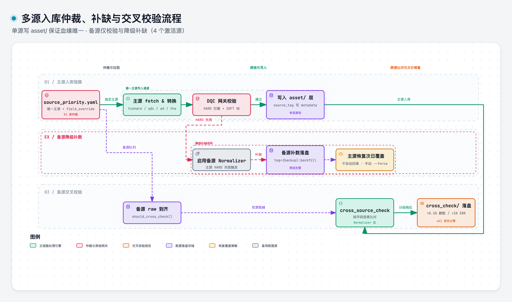

# ingestion

> 域：data · 对应代码 [data/ingestion.py](../../../data/ingestion.py)

## 职责与边界

多源入库的**仲裁与编排**：谁是主源、备源何时上场、两源数据怎么比、缺数怎么补。单条链路的拉取在 [source_adapter.md](source_adapter.md)，DQC 在 `dqc_*`，落盘在 [quarantine_raw.md](quarantine_raw.md) / `storage_*`；本模块回答「**多个源之间怎么协作**」。

核心原则一句话：**单源写入 asset 层、多源交叉校验**——备源只校验补缺，不混合写入。

### 多源仲裁与交叉校验流程



> [打开 Archify 交互图](../.diagrams/06-multi-source-ingestion.html)

## 接口签名

```yaml
# source_priority.yaml — 主源指定表
bars_daily:    {priority: [tushare, akshare], field_override: {adjfactor: tushare}}
bars_minute:   {priority: [tushare]}
fundamental:   {priority: [akshare, tushare], field_override: {pe_ttm: tushare}}
option_basic:  {priority: [amazingdata]}
reference:     {calendar: ..., industry: ...}   # 按表指定
```

```python
@dataclass
class MismatchDetail:   # 按字段聚合（非逐 ticker 明细）
    field: str
    mismatch_count: int; mismatch_rate: float; max_abs_diff: float
    sample_tickers: list[str]   # 前 5 个不一致的 ticker

@dataclass
class CrossCheckResult:
    asset_type: str; trade_date: str
    primary_source: str; secondary_source: str
    total_rows: int; matched_rows: int
    mismatched_fields: dict[str, MismatchDetail]
    missing_in_primary: int; missing_in_secondary: int

def cross_source_check(df_a, df_b, asset_type) -> CrossCheckResult: ...
def should_cross_check(...) -> bool:   # hook：主源入库完成 + 备源 raw 已到达
```

容差（按字段类）：price 0.01 绝对 / volume,amount 0.001 相对 / adjfactor 1e-6 / pe_pb 0.02 / default 0.001。

对比时机：**Normalizer 之后、两源都入库后**才比。

### 跨源校验节奏与响应

| 项 | 定稿 |
|---|---|
| 频率 | 日频每天；分钟频每周抽 1 天；reference 每次更新；factor 不做 |
| 结果落盘 | `cross_check/{asset_type}/{date}.json`（明细）+ `summary.parquet` |
| <0.1% 不一致 | 静默记录 |
| 0.1–1% | WARNING |
| >1% | ERROR |
| adjfactor 不一致 | **始终告警** |

### 备源补数

允许，但严格标记：`source_tag = "{backup}:backfill"` 写入 Parquet **metadata**（不是数据列）。主源恢复后**次日覆盖**；不自动回填，手动 `--force`。

## 关键决策

| 决策 | 否决项 | 理由 |
|---|---|---|
| 单源写 asset，备源只校验/补缺 | 多源混合写入 | 血缘清晰，问题可追到源 |
| **不做自动主源选举** | 主源挂了自动切备源为主 | 静默换人是事故温床 |
| `source_priority.yaml` 按 asset_type  | 硬编码优先级 | 字段级覆盖 |
| 跨源对比在 Normalizer 后 | raw 对比 | raw 列名口径不同 |
| 对比容差按字段类给 | 全局单一容差 | 价格/成交量/比率的误差量纲不同 |
| 分级响应 + adjfactor 永远告警 | 不一致即拒收 | 跨源合理误差存在，硬拒频繁误杀 |
| 备源补数写 metadata 不写数据列 | 加 source 列污染 schema | asset 层 schema 稳定，血缘走 Parquet metadata |

**必须规避的坑**：某数据源在 `suspend==1` 时把 `adjfactor` 写死为 1。**每个 SourceAdapter 的字段映射逻辑必须有测试覆盖**，重点边界：停牌、缺值、CA 事件。

## 实现要点

详见 [data/ingestion.py](../../../data/ingestion.py)

入库流程:
1. 主源fetch→DQC→写asset
2. 备源raw到达后交叉校验→落 `cross_check/` 结果并分级响应
3. 主源HARD失败+备源可用→fallback补数(带backfill标记+降级告警)

核心约定:
- field_override 里的字段从指定源取值替换(如 adjfactor只信tushare)
- 新增数据源=Adapter + Normalizer + source_priority.yaml加一行
- source_priority.yaml存放于 config/(git追踪)
