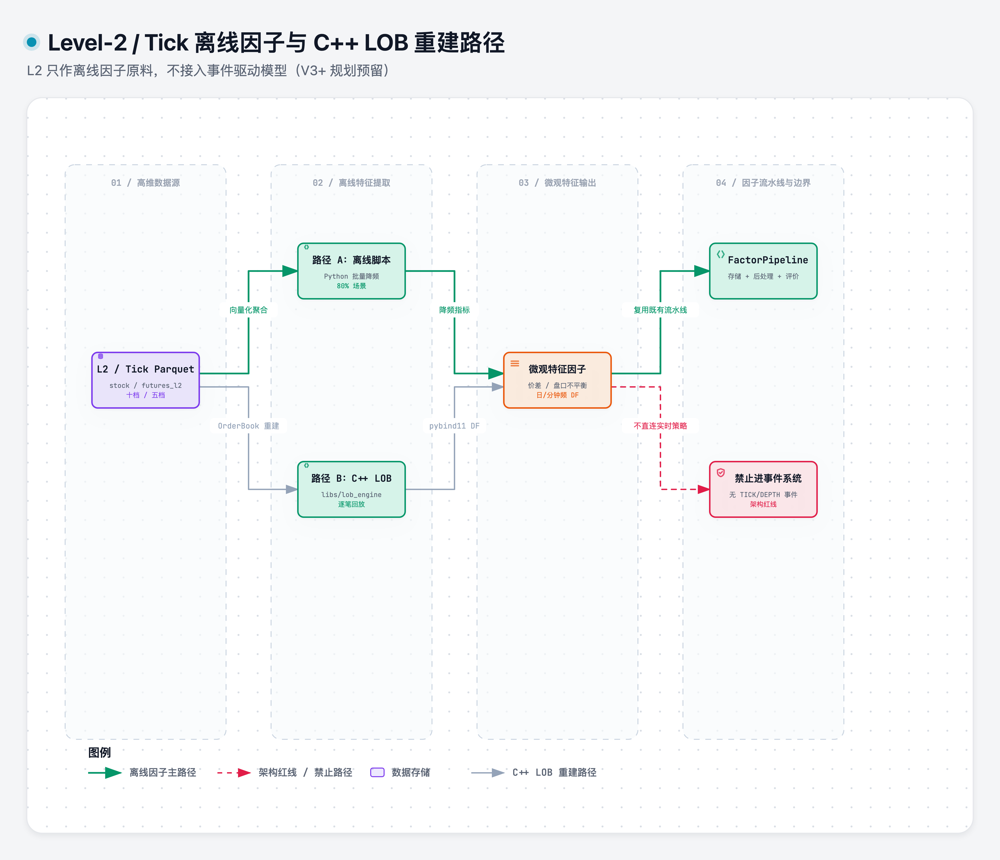

# l2_data

> 域：data · 对应代码 `data/level2_data.py`（V3+ 规划预留，尚未实现）

## 职责与边界

L2 / Tick 数据的**使用路径裁决**：只做「离线因子原料」 + C++LOB重建。Level2数据不进时间流，不做tick实时策略。

### Level-2 / Tick 两条离线因子路径

> [打开 Archify 交互图](../.diagrams/05-level2-dataflow.html)

两条路径的输出都是日频/分钟频因子值，走既有 `factor` 存储和评价流水线。

边界：L2 是因子的原材料，不是事件流的一部分——如同「每日成交量」是 BarData 的字段而不是事件。**80% 的 L2 使用场景走这条路**，零新增架构。

## 关键决策

| 决策 | 否决项 | 一句话理由 |
|---|---|---|
| L2 = 离线因子原料 | 同时做 tick 实时路径 | 80% 场景已覆盖，且完全落在既有流水线内 |
| **不加 TICK / DEPTH_UPDATE 事件** | 在当前事件模型里扩枚举 | tick 驱动是另一个系统，不是加两个事件 |
| 因子以日频/分钟频输出 | L2 数据直接进策略 | 与「成交量是 BarData 字段」同构 |
| LOB引擎重建用cpp| 纯python | 逐笔数据量大，python不够快 |
| cpp通过 pybind11输出DataFrame | cpp独立系统 | 薄壳架构，cpp只做计算密集的部分 |

## LOB重建路径

逐笔回放构建 OrderBook 快照序列后，提取微观结构特征（买卖价差 / 盘口不平衡 / 深度分布 / 成交速率 / 大单占比等），输出 `DataFrame (ticker, datetime, feature_1, feature_2, ...)` 并聚合为日频/分钟频因子进入既有 `FactorPipeline / alphalens`。

C++部分的边界:
- 输入:读Parquet(ArrowC++或  或 pandas 传入)
- 输出:特征 DataFrame(通过 pybind11 返回)
- 不做:存储、DQC、调度--仍由Python平台层负责
- 编译:独立 CMake项目,pipinstall-e libs/lob_engine构建 Python扩展

 ## 数据规模与存储
逐笔数据:~2500万行/天(5000只×~5000笔)
五档快照:~1200万行/天(5000只×~2400条/天)
存储:按日+按板块分组,单文件目标50-100MB(见 [storage_schema.md](storage_schema.md))

L2入库走既有流水线(raw→normalize→DQC→asset),不需要新架构。

## 实现要点
V3+实现,当前只登记路径,不实现代码。
核心约定:
- LOB 重建是独立 C++模块(Libs/lob_engine/),暴露 rebuild_Lob(df) -> features_df 接口
- 特征输出为标准DataFrame,聚合后走factor存储规范
- L2表schema见storage_schema.md的V3+预留
- 不需要:新事件类型、新时间模型、tick回放引擎、on_tick()策略接口
