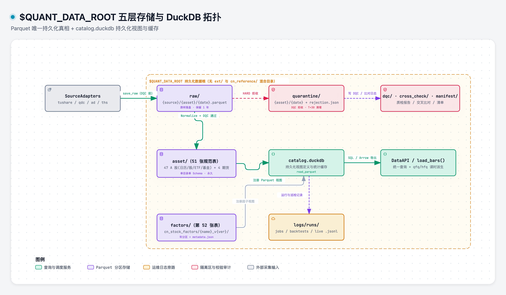

# storage_schema

> 域：data · 对应代码 [data/storage_schema.py](../../../data/storage_schema.py)

## 职责与边界

存储的**结构契约**：两层职责划分、52 张规范表 Schema、通用列约定、字段精度与演进规则。

- **两层**：Parquet = 持久化唯一真相；DuckDB = 持久化 `catalog.duckdb` 视图与统计缓存引擎（基于 `read_parquet`，否决纯内存模式）。
- **52 张规范表**：**47 张 A 股域表**（1 日历 + 36 股票 `cn_stock_*` + 5 独立 ETF `cn_etf_*` + 5 公募基金 `cn_fund_*`）+ **4 张期货表**（`cn_futures_*`）+ **1 张因子表**（`factor`）。原 `ext/` 取消独立顶层，全部按 `{nation}_{asset_type}_{data_type}` 落入 `asset/`。
- **单目录单 Schema**：每张表独立占一个扁平目录，消除共用目录导致 DuckDB `read_parquet` 视图列冲突问题（原 `cn_reference/` 下表已下沉至独立目录）。
- **精度与演进**：一开始选上限类型（DOUBLE/INT64），Schema 只增列不改类型/列名（新增列须同时设 `nullable=True, required=False`）。

边界：不引入 ClickHouse 且**不预留接口**；写入与查询行为不在本模块（→ [storage_ops.md](storage_ops.md)、[data_api.md](data_api.md)）。

## 目录布局



> [打开 Archify 交互图](../.diagrams/03-storage-topology.html)

扁平一层，资产与数据类型编码在文件夹前缀 `{nation}_{asset_type}_{data_type}`：

```text
$QUANT_DATA_ROOT/
├── catalog.duckdb                              # DuckDB 视图定义 + 统计缓存
├── asset/                                      # 51 张原始/标准资产表（含原 ext/ 数据）
│   ├── cn_calendar/{exchange}.parquet
│   │
│   ├── cn_stock_basic/stock_basic.parquet
│   ├── cn_stock_bars_daily/{date}.parquet
│   ├── cn_stock_bars_minute/{date}.parquet
│   ├── cn_stock_fundamental/{month}.parquet
│   ├── cn_stock_daily_status/{month}.parquet
│   ├── cn_stock_corporate_actions/corporate_actions.parquet
│   ├── cn_stock_index_basic/index_basic.parquet
│   ├── cn_stock_index_bars_daily/{month}.parquet
│   ├── cn_stock_industry/industry.parquet
│   ├── cn_stock_index_weights/{year}.parquet
│   ├── cn_stock_fundamental_{income,balance,cashflow,indicator,segment,earnings}/{year}.parquet
│   ├── cn_stock_fundamental_consensus/{month}.parquet
│   ├── cn_stock_hsgt_market_flow/market_flow.parquet
│   ├── cn_stock_{auction,moneyflow,hsgt_hold,margin,lhb,lhb_seats,limit_pool,chips_perf}/{month}.parquet
│   ├── cn_stock_{holder_num,block_trade,repurchase}/{holder_num,block_trade,repurchase}.parquet
│   ├── cn_stock_{top_holders,restricted_release,holder_trade,pledge,research_visits}/{year}.parquet
│   ├── cn_stock_{tick,tick_l2}/{date}.parquet
│   │
│   ├── cn_etf_basic/etf_basic.parquet
│   ├── cn_etf_{bars_daily,bars_minute,tick}/{date}.parquet
│   ├── cn_etf_fundamental/{month}.parquet
│   │
│   ├── cn_fund_{basic,managers,dividend}/{fund_basic,managers,dividend}.parquet
│   ├── cn_fund_nav/{month}.parquet
│   ├── cn_fund_portfolio/{year}.parquet
│   │
│   ├── cn_futures_{bars_daily,tick_l2}/{date}.parquet
│   ├── cn_futures_contract_specs/contract_specs.parquet
│   └── cn_futures_continuous/{symbol}.parquet
│
├── factors/{nation}_{asset_type}_{data_type}/{name}_v{version}/{year}.parquet   # 与 asset/ 同级
├── raw/{source}/{asset_type}/{date}.parquet
├── quarantine/{asset_type}/{date}.parquet
├── dqc/
├── cross_check/
└── manifest/
```

分区策略：
- **日线 / 分钟 / Tick / L2 高频行情**（`{date}.parquet`）：按日一文件 `YYYY-MM-DD.parquet`。
- **日频小截面表**（`{month}.parquet`）：按自然月一文件 `YYYY-MM.parquet`（按 `trade_date` / `nav_date` 原子合并写入，避免 <1MB 碎文件）。
- **低频财报 / 持仓 / 权重 / 公司事件流水**（`{year}.parquet`）：按年分区 `YYYY.parquet`。
- **静态主表 / 全量小事件表**：单表全量一文件（或 `cn_calendar` 按 `{exchange}.parquet`、连续合约按 `{symbol}.parquet`）。
- **因子**：`factors/cn_stock_factors/{name}_v{version}/{year}.parquet` 年分区 + `metadata.json`。

## 52 张表总览

以 [data/storage_schema.py](../../../data/storage_schema.py) 的 Pandera 契约为唯一代码权威；历史短别名（`bars_daily` / `fundamental` / `calendar` / `industry` / `corporate_actions` / `bars_minute` / `bars_daily_futures` / `tick_futures_l2` / `contract_specs` / `continuous`）通过 `LEGACY_TO_CANONICAL` 透明解析。

每张表的**完整字段、类型、可空约束、数据源优先级与交叉比对列字典**见分域文档 [asset/](asset/README.md)：
- [01-stock-core-and-status.md](asset/01-stock-core-and-status.md)（日历 + 股票核心与风控状态，7 张）
- [02-stock-index-and-board.md](asset/02-stock-index-and-board.md)（指数 / 行业 / 概念板块与权重，4 张）
- [03-stock-fundamental-pit.md](asset/03-stock-fundamental-pit.md)（PIT 财务报表、业绩事件与一致预期，7 张）
- [04-stock-flows-and-events.md](asset/04-stock-flows-and-events.md)（资金流 / 情绪 / 筹码 + #29 股东资本事件拆表，17 张）
- [05-stock-tick-l2.md](asset/05-stock-tick-l2.md)（股票逐笔成交与十档 L2，2 张）
- [06-etf-and-fund.md](asset/06-etf-and-fund.md)（独立 ETF + 公募基金，10 张）
- [07-futures.md](asset/07-futures.md)（期货日线、五档 L2、规格与主连，4 张）

### 1. 日历（1 张）

| 表名 | 文件路径 | 分区 | 关键列 / 约束 |
|---|---|---|---|
| `cn_calendar` | `asset/cn_calendar/{exchange}.parquet` | 按交易所 | 1 列 `trade_date`；9 交易所（sse/szse/bse/cffex/shfe/dce/czce/ine/gfex） |

### 2. A 股股票核心与状态（6 张）

| 表名 | 文件路径 | 分区 | 关键列 / 约束 |
|---|---|---|---|
| `cn_stock_basic` | `asset/cn_stock_basic/stock_basic.parquet` | 全量 | 9 列：股票档案、上市/退市日、港股通、北交所 `old_code`；PK(`ticker`) |
| `cn_stock_bars_daily` | `asset/cn_stock_bars_daily/{date}.parquet` | 日 | 14 列（未复权 OHLCV + `adjfactor` + `quality_flag`）；PK(`ticker`, `trade_date`) |
| `cn_stock_bars_minute` | `asset/cn_stock_bars_minute/{date}.parquet` | 日 | 10 列（无 `adjfactor`，含 `datetime`）；PK(`ticker`, `trade_date`, `datetime`) |
| `cn_stock_fundamental` | `asset/cn_stock_fundamental/{month}.parquet` | 月 | 11 列：总/流通市值、PE/PB/PS（可空）、股本、`quality_flag`；PK(`ticker`, `trade_date`) |
| `cn_stock_daily_status` | `asset/cn_stock_daily_status/{month}.parquet` | 月 | 14 列：日频风控状态集中表（涨跌停价/幅度、`is_st`/`is_suspend`/触板/除权） |
| `cn_stock_corporate_actions` | `asset/cn_stock_corporate_actions/corporate_actions.parquet` | 全量 | 10 列：分红/拆股/配股/送转；PK(`ticker`, `ex_date`, `event_type`) |

### 3. 股票指数 / 行业 / 成分权重（4 张）

| 表名 | 文件路径 | 分区 | 关键列 / 约束 |
|---|---|---|---|
| `cn_stock_index_basic` | `asset/cn_stock_index_basic/index_basic.parquet` | 全量 | 7 列：指数档案、`category`/`publisher`/基日基点；PK(`ticker`) |
| `cn_stock_index_bars_daily` | `asset/cn_stock_index_bars_daily/{month}.parquet` | 月 | 14 列：指数 OHLCV + PE/PB/市值/换手 + `quality_flag`；PK(`ticker`, `trade_date`) |
| `cn_stock_industry` | `asset/cn_stock_industry/industry.parquet` | 全量 | 6 列：`classification` (`citics`/`sw`/`ths`/`tdx`) + L1-L3；PK(`ticker`, `classification`) |
| `cn_stock_index_weights` | `asset/cn_stock_index_weights/{year}.parquet` | 年 | 6 列：`index_code`、`ticker`、`trade_date`、`weight`、`in_date`/`out_date` |

### 4. PIT 财务报表、业绩事件与一致预期（7 张）

统一采用 `cn_stock_fundamental_*` 前缀，强制包含 `ann_date`（或 `visible_from`）防未来函数：

| 表名 | 文件路径 | 分区 | 关键列 / 约束 |
|---|---|---|---|
| `cn_stock_fundamental_income` | `asset/cn_stock_fundamental_income/{year}.parquet` | 年 | 19 列：PIT 利润表；PK(`ticker`, `report_date`, `ann_date`, `statement_type`) |
| `cn_stock_fundamental_balance` | `asset/cn_stock_fundamental_balance/{year}.parquet` | 年 | 18 列：PIT 资产负债表；PK(`ticker`, `report_date`, `ann_date`, `statement_type`) |
| `cn_stock_fundamental_cashflow` | `asset/cn_stock_fundamental_cashflow/{year}.parquet` | 年 | 14 列：PIT 现金流量表；PK(`ticker`, `report_date`, `ann_date`, `statement_type`) |
| `cn_stock_fundamental_indicator` | `asset/cn_stock_fundamental_indicator/{year}.parquet` | 年 | 17 列：PIT 盈利/偿债/成长/审计指标；PK(`ticker`, `report_date`, `ann_date`) |
| `cn_stock_fundamental_segment` | `asset/cn_stock_fundamental_segment/{year}.parquet` | 年 | 10 列：主营分行业/产品/地区营收成本毛利；PK(`ticker`, `report_date`, `segment_type`, `segment_name`) |
| `cn_stock_fundamental_earnings` | `asset/cn_stock_fundamental_earnings/{year}.parquet` | 年 | 15 列：业绩预告/快报/预约披露日程（`event_kind` 区分） |
| `cn_stock_fundamental_consensus` | `asset/cn_stock_fundamental_consensus/{month}.parquet` | 月 | 14 列：PIT 一致预期（`eps_fy0..2`/`eps_fwd12m`/`rating_score`/`tp_median`） |

### 5. 资金流 / 情绪 / 筹码（9 张）

| 表名 | 文件路径 | 分区 | 关键列 / 约束 |
|---|---|---|---|
| `cn_stock_auction` | `asset/cn_stock_auction/{month}.parquet` | 月 | 11 列：开盘/收盘集合竞价；PK(`ticker`, `trade_date`, `auction_session`) |
| `cn_stock_moneyflow` | `asset/cn_stock_moneyflow/{month}.parquet` | 月 | 13 列：超大/大/中/小单及净流入金额占比；PK(`ticker`, `trade_date`) |
| `cn_stock_hsgt_market_flow` | `asset/cn_stock_hsgt_market_flow/market_flow.parquet` | 全量 | 8 列：南北向市场资金流水 + `is_turnover_regime`（2024-08-19 口径切换标记） |
| `cn_stock_hsgt_hold` | `asset/cn_stock_hsgt_hold/{month}.parquet` | 月 | 6 列：陆股通个股持股量与占比；PK(`ticker`, `trade_date`) |
| `cn_stock_margin` | `asset/cn_stock_margin/{month}.parquet` | 月 | 11 列：个股融资融券余额与买入卖出额；PK(`ticker`, `trade_date`) |
| `cn_stock_lhb` | `asset/cn_stock_lhb/{month}.parquet` | 月 | 11 列：龙虎榜每日上榜个股统计；PK(`ticker`, `trade_date`, `reason`) |
| `cn_stock_lhb_seats` | `asset/cn_stock_lhb_seats/{month}.parquet` | 月 | 10 列：龙虎榜席位/游资/机构买卖前五明细；PK(`ticker`, `trade_date`, `side`, `rank`, `seat_name`) |
| `cn_stock_limit_pool` | `asset/cn_stock_limit_pool/{month}.parquet` | 月 | 10 列：涨停/跌停/炸板池与连板天数；PK(`ticker`, `trade_date`, `pool_type`) |
| `cn_stock_chips_perf` | `asset/cn_stock_chips_perf/{month}.parquet` | 月 | 12 列：筹码分布胜率与 5/15/50/85/95 分位成本；PK(`ticker`, `trade_date`) |

### 6. 股东与资本事件（#29 拆表为 8 张独立表）

| 表名 | 文件路径 | 分区 | 关键列 / 约束 |
|---|---|---|---|
| `cn_stock_holder_num` | `asset/cn_stock_holder_num/holder_num.parquet` | 全量 | 6 列：股东户数与户均持股；PK(`ticker`, `end_date`, `ann_date`) |
| `cn_stock_top_holders` | `asset/cn_stock_top_holders/{year}.parquet` | 年 | 10 列：前十大股东/流通股东；PK(`ticker`, `end_date`, `holder_scope`, `rank`, `holder_name`) |
| `cn_stock_restricted_release` | `asset/cn_stock_restricted_release/{year}.parquet` | 年 | 8 列：限售解禁明细与占比；PK(`ticker`, `float_date`, `holder_name`, `share_type`) |
| `cn_stock_block_trade` | `asset/cn_stock_block_trade/block_trade.parquet` | 全量 | 9 列：大宗交易价量与折价率；PK(`ticker`, `trade_date`, `seq`) |
| `cn_stock_repurchase` | `asset/cn_stock_repurchase/repurchase.parquet` | 全量 | 9 列：股份回购进度/金额/价格区间；PK(`ticker`, `ann_date`, `proc`) |
| `cn_stock_holder_trade` | `asset/cn_stock_holder_trade/{year}.parquet` | 年 | 11 列：重要股东增减持明细；PK(`ticker`, `ann_date`, `holder_name`, `in_de`) |
| `cn_stock_pledge` | `asset/cn_stock_pledge/{year}.parquet` | 年 | 9 列：股权质押与解押明细；PK(`ticker`, `ann_date`, `holder_name`, `start_date`) |
| `cn_stock_research_visits` | `asset/cn_stock_research_visits/{year}.parquet` | 年 | 7 列：机构调研记录；PK(`ticker`, `surv_date`, `org_name`) |

### 7. 股票逐笔与十档 L2（2 张）

| 表名 | 文件路径 | 分区 | 关键列 / 约束 |
|---|---|---|---|
| `cn_stock_tick` | `asset/cn_stock_tick/{date}.parquet` | 日 | 9 列：逐笔成交（`volume` 已换算为股，`bs_flag`）；PK(`ticker`, `trade_date`, `seq`) |
| `cn_stock_tick_l2` | `asset/cn_stock_tick_l2/{date}.parquet` | 日 | 49 列：10 档买卖盘口（40 列）+ 基础 8 列 + `quality_flag`；PK(`ticker`, `trade_date`, `seq`) |

### 8. 独立 ETF 域（5 张，暂不落 `cn_etf_pcf`）

| 表名 | 文件路径 | 分区 | 关键列 / 约束 |
|---|---|---|---|
| `cn_etf_basic` | `asset/cn_etf_basic/etf_basic.parquet` | 全量 | 12 列：ETF 档案、跟踪指数、管理费/托管费；PK(`ticker`) |
| `cn_etf_bars_daily` | `asset/cn_etf_bars_daily/{date}.parquet` | 日 | 14 列：ETF 独立日线 + `adjfactor`；PK(`ticker`, `trade_date`) |
| `cn_etf_bars_minute` | `asset/cn_etf_bars_minute/{date}.parquet` | 日 | 10 列：ETF 分钟线（无 `adjfactor`）；PK(`ticker`, `trade_date`, `datetime`) |
| `cn_etf_fundamental` | `asset/cn_etf_fundamental/{month}.parquet` | 月 | 9 列：单位/累计净值、净值复权因子、IOPV、场内份额与总净值；PK(`ticker`, `trade_date`) |
| `cn_etf_tick` | `asset/cn_etf_tick/{date}.parquet` | 日 | 9 列：ETF 逐笔成交；PK(`ticker`, `trade_date`, `seq`) |

### 9. 场外与 LOF 公募基金（5 张）

| 表名 | 文件路径 | 分区 | 关键列 / 约束 |
|---|---|---|---|
| `cn_fund_basic` | `asset/cn_fund_basic/fund_basic.parquet` | 全量 | 13 列：`.OF` 与 `50/16` 基金档案、`market` (`O`/`E`)、业绩基准；PK(`ticker`) |
| `cn_fund_managers` | `asset/cn_fund_managers/managers.parquet` | 全量 | 7 列：基金经理任期起止；PK(`ticker`, `name`, `begin_date`) |
| `cn_fund_nav` | `asset/cn_fund_nav/{month}.parquet` | 月 | 10 列：净值日序列 + 复权净值 + 份额与净资产；PK(`ticker`, `nav_date`) |
| `cn_fund_dividend` | `asset/cn_fund_dividend/dividend.parquet` | 全量 | 7 列：公募基金分红；PK(`ticker`, `ex_date`, `ann_date`) |
| `cn_fund_portfolio` | `asset/cn_fund_portfolio/{year}.parquet` | 年 | 10 列：季报重仓明细（`stock`/`bond`/`fund`/`other`）；PK(`ticker`, `end_date`, `symbol`) |

### 10. 期货与因子（4 + 1 张）

| 表名 | 文件路径 | 分区 | 关键列 / 约束 |
|---|---|---|---|
| `cn_futures_bars_daily` | `asset/cn_futures_bars_daily/{date}.parquet` | 日 | 11 列：期货日线 + `settle`/`open_interest`；无 `adjfactor`；PK(`ticker`, `trade_date`) |
| `cn_futures_tick_l2` | `asset/cn_futures_tick_l2/{date}.parquet` | 日 | 28 列：5 档盘口（20 列）+ 8 基础列；PK(`ticker`, `trade_date`, `datetime`) |
| `cn_futures_contract_specs` | `asset/cn_futures_contract_specs/contract_specs.parquet` | 全量 | 12 列：乘数、最小变动价位、交割月、限价与保证金率；PK(`ticker`) |
| `cn_futures_continuous` | `asset/cn_futures_continuous/{symbol}.parquet` | 按品种 | 11 列：主连行情 + `dominant_contract` + 换月累积 `adjfactor`；无 `close_adj`；PK(`trade_date`) |
| `factor` | `factors/cn_stock_factors/{name}_v{version}/{year}.parquet` | 年 | 3 列：`ticker`/`date`/`{name}(Y)`；版本目录 + `metadata.json`，无 `quality_flag` |

## 通用约定

- **ticker 格式**（[core/asset_rules.py](../../../core/asset_rules.py)）：
  - **股票**：`^(?:60|68)\d{4}\.SH\Z`、`^(?:00|30)\d{4}\.SZ\Z`、`^(?:43|83|87|92)\d{4}\.BJ\Z`（含北交所 `92` 段）
  - **ETF**：`^(?:51|52|53|55|56|58)\d{4}\.SH\Z`、`^15\d{4}\.SZ\Z`（含沪市 `52/53/55` 段）
  - **公募基金**：场外 `^\d{6}\.OF\Z` + 场内 LOF `^50\d{4}\.SH\Z` / `^16\d{4}\.SZ\Z`
  - **指数**：`^\d{6}\.(SH|SZ|BJ|CSI|CNI|SI|CI|TI|DC|TS)\Z`
  - **期货**：`^[A-Z]{1,2}\d{4}\.(CFFEX|SHFE|DCE|CZCE|INE|GFEX)\Z`
- **quality_flag**：`int64` 位掩码（`CLEAN = 0`，5 bits，`< 32`：bit0=C02_COVERAGE / bit1=C05_NULL_RATE / bit2=L04_BEYOND_LIMIT / bit3=L07_ADJFACTOR_RANGE / bit4=K01_OVERNIGHT_GAP）。仅行级行情/估值/净值/资金流类表携带，纯静态档案/公告/因子表不带。
- **不含派生列**：`prev_close`（仅 `cn_stock_daily_status` 存涨跌停基准价除外）/ `pct_change` / `close_adj` 等全历史复权派生值一律读时计算；前复权 `qfq = raw × adj / adj_latest` 永不落盘。
- **分钟线与 Tick 无 `adjfactor`**：日级复权因子存 240/数千遍冗余，读时从对应日线表 join。
- **可空整数字段约定**：含可空语义的整数型统计列（如开板次数、连板天数、排名）在 Pandera Schema 中定义为 `float` + `nullable=True`，避免 pandas 缺失值自动转 `float64` 触发强整型校验失败。

## 关键决策

| 决策 | 否决项 | 一句话理由 |
|---|---|---|
| Parquet + DuckDB catalog | ClickHouse | 单机轻量化、零外部依赖 |
| 持久化 `catalog.duckdb` | 纯内存模式 | 视图和统计缓存避免重建 |
| 原 `ext/` 取消并全部落入 `asset/` | 独立 `ext/` 顶层 | 统一规范命名、纳入 Pandera 契约并直接入 DuckDB 视图 |
| 每表独立扁平目录 `{nation}_{asset_type}_{data_type}/` | 共用 `cn_reference/` 等混合目录 | 防止 `read_parquet('dir/*.parquet')` 跨 Schema 冲突 |
| 股票日频小截面按 `{month}.parquet` 分区 | 按日小文件 | 避免 <1MB 碎文件导致 footer 与打开开销过高 |
| ETF 独立建表、#29 事件拆为 8 张表 | 与股票混表或宽泛大 JSON 事件表 | 避免 ETF 净值/份额字段为空冗余，保持单表强 Schema 与高压缩比 |
| 价格 DOUBLE；volume INT64；只增列不改名 | float32 / 显式版本重构 | 避免精度问题与历史数据全量重写；`union_by_name` 原生向后兼容 |

## 实现要点

详见 [data/storage_schema.py](../../../data/storage_schema.py)：
- `SCHEMA`、`PARTITION_PATHS`、`TABLE_FAMILY` 均使用 `_AliasedDict` 包装，只以 52 个规范名作为标准键集合（`len(SCHEMA) == 52`），同时对 10 个旧短别名透明解析，保障 `storage_ops.py`、`dqc/engine.py` 等既有调用平滑兼容。
- 写入前由 `ingest_with_dqc` / `write_parquet_atomic` 双重校验，原子落盘配置见 `storage_ops.PARQUET_WRITE_CONFIG`。
