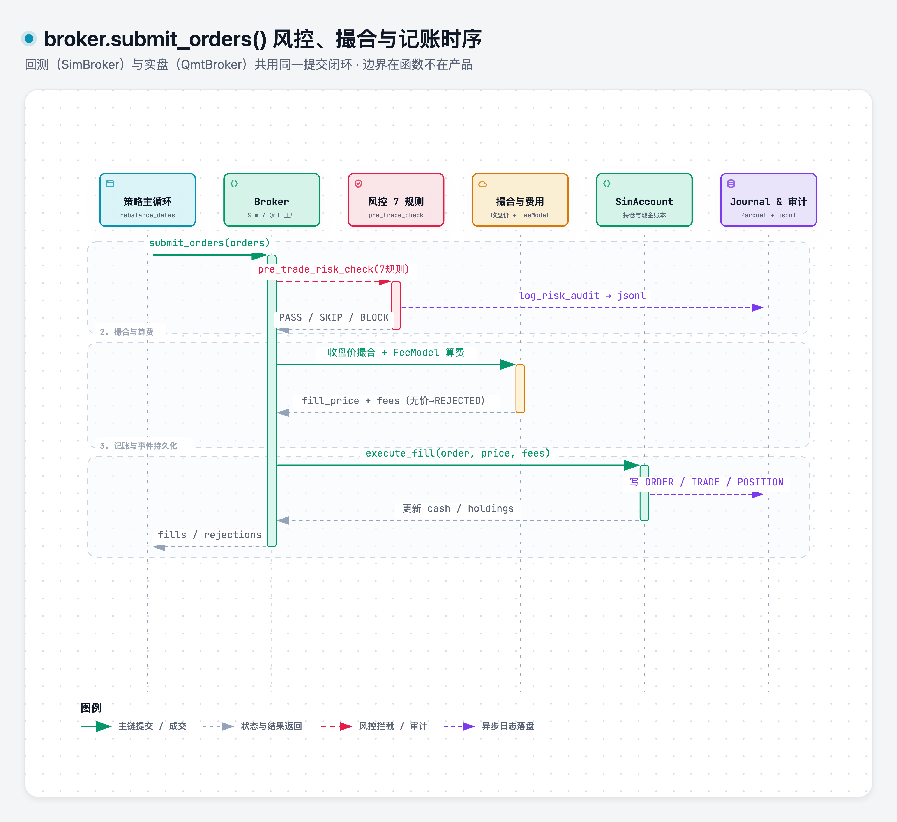

# broker

> 域：execution · 对应代码 [execution/broker.py](../../../execution/broker.py)

## 职责与边界

柜台抽象与撮合：`Broker` ABC 四方法封顶，`SimBroker`（回测/paper 共用）与 `QmtBroker`（V2 实盘）经工厂切换——**回测与实盘同一代码路径**，差异只注入在 Broker 实现。`submit_orders()` 内部三步 = 风控 + 撮合 + 记账。不做撤单/改单/行情/事件回调。

### submit_orders() 闭环时序



> [打开 Archify 交互图](../.diagrams/13-broker-submit-sequence.html)

## 接口签名

```python
class Broker(ABC):
    """柜台抽象。4 方法封顶。"""
    @abstractmethod
    def submit_orders(self, orders: list[dict]) -> list[dict]: ...
    @abstractmethod
    def get_holdings(self) -> dict[str, int]: ...
    @abstractmethod
    def get_cash(self) -> float: ...
    @abstractmethod
    def get_nav(self) -> float: ...

class SimBroker(Broker):
    """模拟柜台：封装 风控+撮合+费用+记账。"""
    def __init__(self, config: dict):
        self.account = SimAccount(config["initial_cash"])
        self.fee_model = FeeModel()

@dataclass
class SimAccount:
    cash: float
    holdings: dict[str, int]           # ticker → 股数
    cost_basis: dict[str, float]       # ticker → 均价（含费摊入）
    trade_log: list[dict]
    def execute_fill(self, order, fill_price, fees): ...
    def get_nav(self, prices) -> float: ...
    def get_snapshot(self, prices) -> dict: ...

def create_broker(mode: str, config: dict) -> Broker:
    """工厂: sim / qmt 切换。mode 读 config[execution].mode。"""
```

**撮合模型 V1**：收盘价成交；无价格 → REJECTED（停牌）；部分成交不模拟（全成或不成）。

## 关键决策

| 决策 | 否决项 | 一句话理由 |
|---|---|---|
| SimBroker/QmtBroker 工厂，同一代码路径 | 回测/实盘两套 | 回测-实盘分歧从根上消除 |
| submit_orders 内部三步（风控+撮合+记账） | Utrade/Themis/TB 三个独立模块 | 接口边界从「产品」移到「函数」 |
| V1 收盘价撮合 | T+1 开盘撮合 | V1 简化（黄金样本对拍用手算口径一致）；保守版用 T+1 开盘 |
| Broker 只 4 方法 | 含 cancel/modify/行情/回调 | 月频够用，V2 再扩 |
| V2 实盘路径 QMT > easytrader > 券商 API | vnpy Gateway | QMT Python API 完善支持 mini-qmt；easytrader 逆向不稳；引整个 vnpy 生态不值 |
| 对拍（B）+ 模拟盘校准期（C）保留为上线流程 | 只靠回测 | fill 层偏差是物理性的，需量化校准；新策略模拟盘 2–4 周过对拍才上真钱 |

## 实现要点

详见 [execution/broker.py](../../../execution/broker.py)

核心约定:
- submit_orders内部三步:pre_trade_risk_check→撮合(取价格成交) account.execute_fill(记账+扣费)
- 工厂 create_broker(mode,config)按 config的 execution.mode切换sim/qmt
- 回测-实盘对拍指标:signal一致率(应100%)/成交价偏差/成交率偏差/累计净值跟踪误差
- 偏差方向全部「实盘比回测更差」,回测是收益上限
