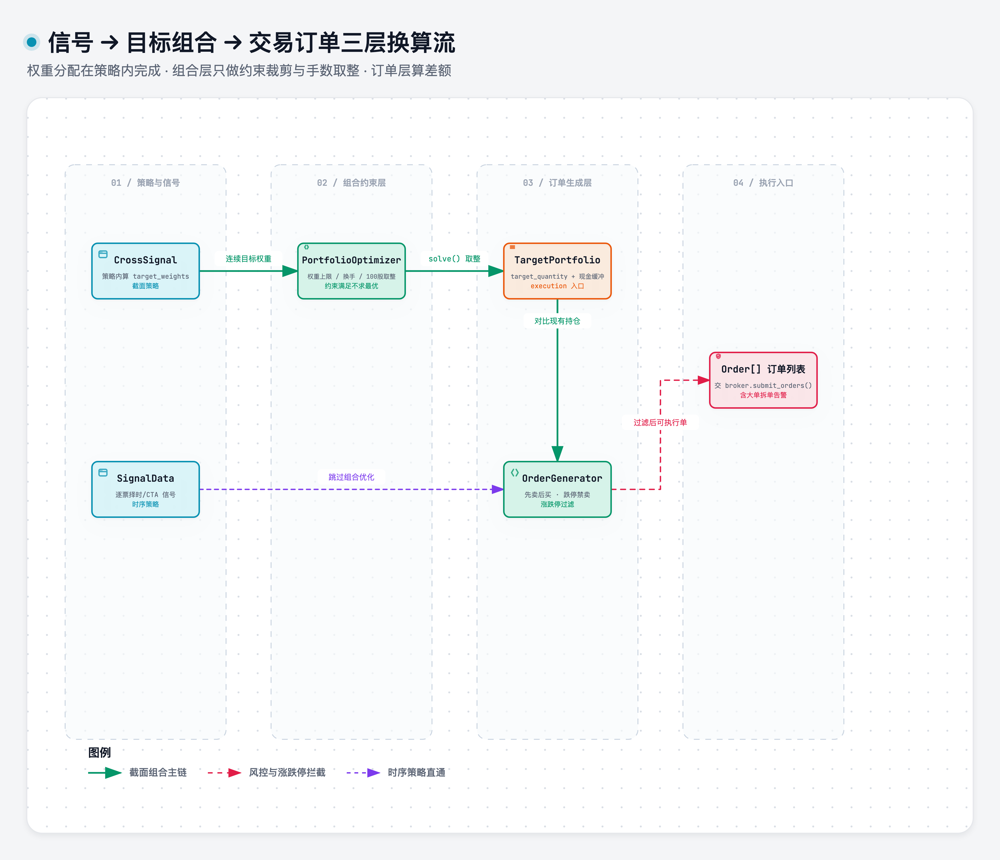

# order_generation

> 域：execution · 对应代码 [execution/order_generation.py](../../../execution/order_generation.py)

## 职责与边界

目标权重 vs 当前持仓 → 差分 → 订单列表。输入 `TargetPortfolio`/目标权重与账户状态，输出 `list[dict]` 订单；**不撮合、不收费用、不做风控**（那是 broker.submit_orders() 内部三步）。

上下游信号 → 组合 → 订单三层换算见下图：



> [打开 Archify 交互图](../.diagrams/11-portfolio-order-dataflow.html)

## 接口签名

```python
def compute_order_diff(
    target_weights: pd.DataFrame,   # [ticker, weight]
    account: "SimAccount",
    nav: float,
) -> list[dict]:
    """目标权重 → 订单差分。
    target_shares = floor(weight × nav / price / lot_size) × lot_size。
    无有效价格（停牌/≤0）直接跳过；diff==0 不产单。"""

def generate_orders(
    target_weights: pd.DataFrame,
    account: "SimAccount",
    nav: float,
) -> list[dict]:
    """全链路: diff → check_split_needed 告警 → 排序(先卖后买)。"""

def check_split_needed(order: dict) -> None:
    """单笔 > 1% 日成交量 → 告警（V1 不拆单）。"""
```

订单 dict 字段：`ticker / side("BUY"|"SELL") / shares / limit_price`。

## 关键决策

| 决策 | 否决项 | 一句话理由 |
|---|---|---|
| 手数取整 floor(w×nav/price/100)×100 | 向上取整 | 向下取整保证不超预算 |
| 先卖后买；卖出按市值 desc；买入按信号 desc | 随机/按 ticker 序 | 释放资金再买入 |
| 拆单 V1 不做，check_split_needed 仅告警 | TWAP/VWAP 拆单 | >1% 日成交量才拆——月频 ETF/大盘股远不到 |
| 挂单 V1 不处理 | 跨日挂单管理 | 月频挂单跨日是高频需求 |
| 订单类型 LIMIT，limit_price = close | 市价单 | 简单诚实；市价单 V2 |

## 实现要点

详见 [execution/order_generation.py](../../../execution/order_generation.py)

核心约定:
- compute_order_diff:逐行取最新价>target_shares=floor(weightx nav/price/lot_size)xlot_size+与holdings求差→非零产单
- generate_orders:diff→check_split_needed告警→排序先卖后买
- 无有效价格(停牌/<0)直接跳过,diff==0不产单
- 价格和成交量数据从 execution/market_data.py获取:get_latest_price / get_prices / get_daily_volume
