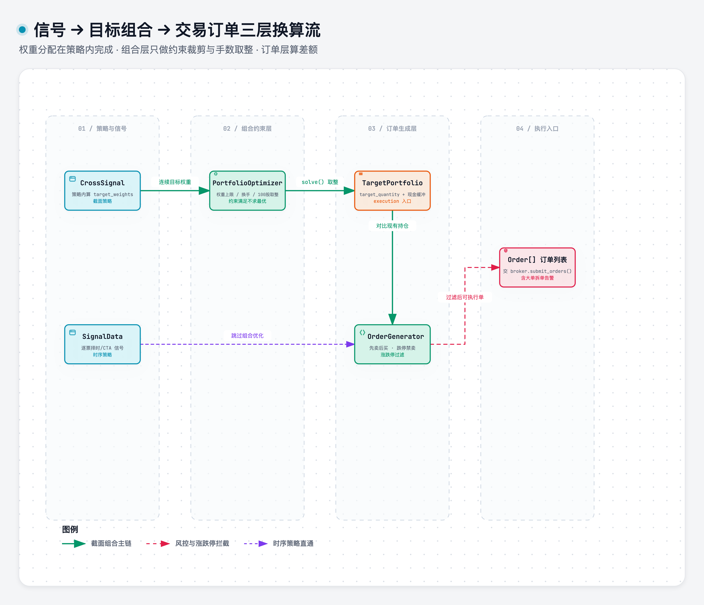

# portfolio_construction

> 域：execution · 对应代码 [execution/portfolio_construction.py](../../../execution/portfolio_construction.py)

## 职责与边界

Signal → Portfolio 的**约束满足层**：接受策略产出的连续目标权重，做约束裁剪 + 手数取整，产出整数手数的 `TargetPortfolio`。

**权重分配（等权 / score 加权 / 风险平价 / 均值-方差四法）发生在策略内部**（scores → weights），本模块**不求最优、只做约束满足**。信号链三层拆分：



> [打开 Archify 交互图](../.diagrams/11-portfolio-order-dataflow.html)

时序策略无此层：`SignalData` 直接转 Order（逐票决策，无组合级约束）。CTA 组合约束（如总保证金上限）将来再做简化版。

## 接口签名

```python
@dataclass
class PortfolioConstraints:          # 可变配置对象
    max_weight: float = 0.10         # 单票权重上限
    min_weight: float = 0.0
    max_turnover: float | None = None    # 换手率上限, turnover = sum(|Δw|)/2
    max_industry_weight: float | None = None
    max_total_weight: float = 0.95   # 留 5% 现金缓冲
    min_cash: float = 0.0
    lot_size: int = 100              # 手数硬约束（优化后执行）
    min_trade_value: float = 5000.0

@dataclass(frozen=True)
class TargetPosition:
    ticker: str
    target_weight: float        # 主单位（优化空间）
    target_quantity: int        # 执行单位（整数手）
    target_notional: float      # 风控/报告用
    ref_price: float            # T 日收盘价，仅用于权重↔股数换算
    side: str                   # "LONG" / "FLAT"

@dataclass(frozen=True)
class TargetPortfolio:
    strategy_id: str
    trade_date: date            # 信号日 T
    exec_date: date             # 执行日 T+1
    create_time: datetime
    positions: dict[str, TargetPosition]
    total_weight: float; num_holdings: int
    cash_weight: float; estimated_turnover: float
    solver_status: str          # "optimal" / "suboptimal" / "infeasible"
    constraints_applied: list[str]
    pre_opt_weights: dict[str, float] | None   # 取整前权重（调试/偏离分析）

class PortfolioOptimizer:
    def solve(self, raw_weights: dict[str, float],
              current_positions: dict[str, Position], account: Account,
              constraints: PortfolioConstraints, prices: dict[str, float],
              industry_map: dict[str, str] | None = None) -> TargetPortfolio: ...
```

换算链：`raw_quantity = w × total_asset / ref_price` → `target_quantity = floor_to_lot(raw_quantity, 100)` → 反算 `actual_weight`。`TargetPortfolio` 存取整后量，`pre_opt_weights` 存取整前。

## 关键决策

| 决策 | 否决项 | 一句话理由 |
|---|---|---|
| 纯 numpy 裁剪两步走 | cvxpy / scipy.optimize | 策略已给目标权重，约束全是 box+线性，不需要二次规划 |
| 约束权威 = `PortfolioConstraints`（solve 入参） | `CrossSignal.max_weight`/`turnover_limit` 字段 | 信号不携带约束——两字段废弃 |
| 手数取整放本模块 | 留在 `cs_portfolio_sim.rebalance()` | rebalance 只做差额→逐笔 |
| 取整做法 1+3（floor 取整+现金缓冲+门槛过滤） | 做法 2 整数规划 ILP | 小组合收益有限，与「不用 cvxpy」一致 |
| 权重为主单位，股数为执行单位 | 只存一种单位 | 优化在权重空间，执行要整数手，三单位共存于 TargetPosition |
| T 日收盘产出 / T+1 执行 | T 日收盘价直接执行 | 防前视 |

## 实现要点

详见 [execution/portfolio_construction.py](../../../execution/portfolio_construction.py)

核心约定:
- solve()两步:约束裁剪(clip weight→clip industry→归一 →  clip turnover) → 手数取整(floor_to_lot + min_trade_value过滤)
- pre_opt_weights记录取整前的连续权重,用于偏离分析
- TargetPortfolio存取整后量,三单位(weight/quantity/notional)共存于TargetPosition
- 时序策略(CTA)无此层,Signal直接转Order
