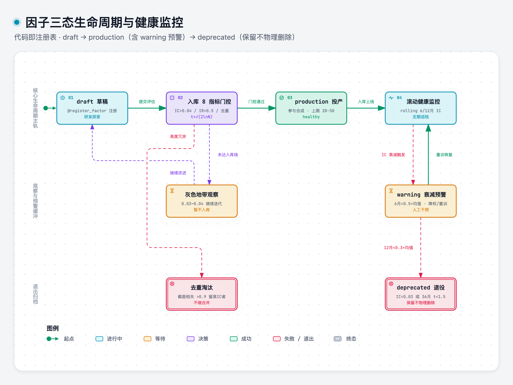

# factor_governance

> 域：research · 对应代码 [research/factor/governance.py](../../../../research/factor/governance.py)

## 职责与边界

因子治理层：入库与退出量化标准、三态生命周期状态机、血缘、命名规范、相似因子去重、容量预算、五分支异常排查、单测四范式与四图诊断报告。消费 [evaluation.md](evaluation.md) 产出的 IC 序列，与 [storage.md](storage.md) 的 `metadata.json`、[runtime.md](runtime.md) 的 `depends_hash` 衔接。

注册表底层机制（`FactorRegistry` / `@register_factor` / 工厂实例化）归 [registry.md](../../core/registry.md)，本模块只定义治理口径与质量工具。

不属于本模块：alphalens tearsheet 与准入流水线（[evaluation.md](evaluation.md)）、多因子合成（[combiner.md](../signal/combiner.md)）、独立外部 JSON/SQLite 因子库（不建）。

## 接口签名

```python
META_FIELDS = [
    "name", "version", "description", "category", "frequency",
    "asset_types", "depends_on", "status", "created_at",
]

def list_factor_meta() -> list[dict[str, Any]]: ...
    # 遍历 FactorRegistry 汇总类属性元数据
def evaluate_factor(factor_values: pd.DataFrame, returns: pd.DataFrame, factor_name: str) -> dict: ...
    # 计算 Spearman 日截面 IC 序列 → {ic_mean, ic_ir, ic_t, n_periods, coverage}
def check_factor_health(ic_history: pd.Series) -> str: ...
    # 返回 "healthy" | "warning" | "exit"（rolling 6 月 / 12 月 IC 对比历史均值）
def check_admission(metrics: dict, max_corr: float) -> tuple[bool, dict]: ...
    # 入库综合门控：IC > 0.04, IR > 0.5, t > 2, 最大相关性 < 0.5
def transition_lifecycle(current: str, target: str) -> str: ...
    # 生命周期状态校验：draft → production → deprecated
def detect_redundant_factors(factor_matrix: pd.DataFrame, threshold: float = 0.7) -> list[tuple[str, str, float]]: ...
    # 按日截面 Spearman 相关取均值，返回超阈值因子对（按 |corr| 降序）
def redundancy_tier(abs_corr: float) -> str: ...
def diagnose_factor(df: pd.DataFrame, factor_name: str) -> dict[str, Any]: ...
    # 异常诊断：nan_ratio / inf_count / zero_ratio / coverage_min / min_date / 值域统计 / cs_std_cv
def plot_factor_report(factor_values: pd.DataFrame, returns: pd.DataFrame, factor_name: str, n_groups: int = 5) -> None: ...
    # 生成 2×2 四图报告 → research/reports/{factor_name}_tearsheet.png
```

### 因子三态生命周期与健康监控

生命周期：`draft →(入库检验通过)→ production →(衰减检测触发)→ deprecated`；`production` 期间 rolling 监控触发 `warning` 时可提前重训或降权，`deprecated` 不物理删除（保留代码与历史数据以支持回测复现）。



> [打开 Archify 交互图](../../.diagrams/10-factor-lifecycle.html)

## 关键决策

| 决策 | 否决项 | 一句话理由 |
|---|---|---|
| 代码即注册表：`FactorRegistry` + 类属性 + `metadata.json` | 独立 JSON/SQLite 注册表 | 因子 <100 遍历足够；消除代码与外部注册表同步漂移 |
| 质量 8 指标：IC / IR / t / 分组单调 / 换手 / 半衰期 / 覆盖率 / 相关性 | 只看 IC | 多维约束有效性与可交易性 |
| 入库线 `IC > 0.04` / `IR > 0.5` / `t > 2` / `相关 < 0.5` / 经济可解释 | 拿退出线当入库线 | 留出灰色观察区，避免低质量因子入库 |
| 退出线 `IC < 0.03` 或 rolling 36 月 `t < 1.5` | 只按单月 IC 一条线 | 区分短期回撤与长期衰减 |
| 三态 `draft → production → deprecated` | 多色运维状态灯 | 状态传导由 `depends_hash` 触发重算替代 |
| 血缘 = `depends_on` + `FactorDAG` + `depends_hash` | 独立血缘表 / per-di 版本记录 | 全量重算很快，依赖关系直接由 DAG 推导 |
| 命名 `{类型}_{核心语义}_{参数}` snake_case | `mom20` / `Momentum20` / `factor_001` | 可读性优先，类构造期由正则强制校验 |
| 文档 = docstring + `description` 类属性 | 为每个因子单独建 markdown | `compute()` 实现即权威定义 |
| 去重：截面 Spearman 均值 > 0.7 标冗余，保留 IC 高者，**不做合并** | 等权合并冗余因子 | 合并引入新自由度；合成统一归 [combiner.md](../signal/combiner.md) |
| `deprecated` 不物理删除 | 删除代码/历史数据 | 保证历史回测复现与审计可追溯 |
| 容量预算 20–50 个因子（`production` 15–20 个） | 无上限堆积 | 多策略共享因子库，过多往往说明去重不足 |
| 多重检验校正 `t = √(2·ln N)` | 固定 `t > 2` 不计尝试次数 | 防止试错堆出来的伪显著通过门控 |
| 单测四范式必含 `test_no_lookahead` | 只测数值对拍 | 显式验证截断未来数据不影响历史因子值 |

## 实现要点

详见 [research/factor/governance.py](../../../../research/factor/governance.py)。

核心约定：
- **健康检查三档**：`recent_6m > 0.7 * mean_ic` → `healthy`；`> 0.5 * mean_ic` → `warning`；`recent_12m < 0.3 * mean_ic` → `exit`。
- **冗余四档**：`|corr| > 0.9` 高度冗余（保留 IC 高者，另一个置 `deprecated`）；`0.7–0.9` 可能冗余（经济逻辑不同可保留）；`0.5–0.7` 警告记录；`< 0.5` 独立。
- **单测四范式**：`test_basic_computation`（手工窗口精确对拍）、`test_nan_handling`（停牌 `NaN` 不污染截面）、`test_output_schema`（列结构断言）、`test_no_lookahead`（删去末尾日期后历史值 `np.allclose(..., equal_nan=True)` 不变）。
- **容量与五分支排查**：经典风险 5–8 / 行业风格 3–5 / 另类 3–5 / ML 2–3；异常按「全部标的→上游数据、特定标的→停牌/ST/退市、特定日期→`depends_hash`、数值范围→除零/溢出/NaN 传播、IC 突变→参数或衰减」五步排查。
