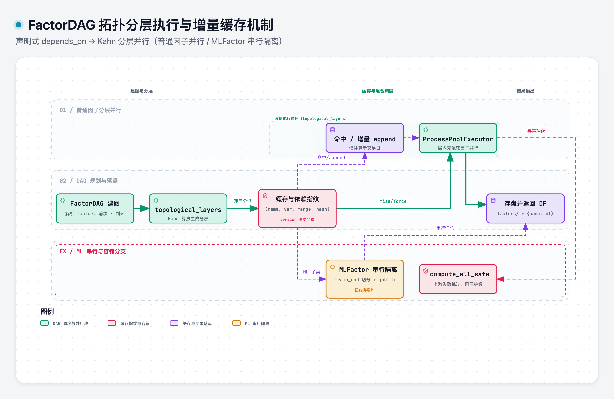

# factor_runtime

> 域：research · 对应代码 [research/factor/runtime.py](../../../../research/factor/runtime.py)

## 职责与边界

`FactorDAG` 静态拓扑构建与执行层：依赖解析、Kahn 拓扑排序与分层、依赖内容指纹与内存缓存、层内并行、失败隔离、以及 `MLFactor` 训练/预测串行调度。消费 [interface.md](interface.md) 的 `depends_on()`，产出 DataFrame 交 [storage.md](storage.md) 落盘与 [post_processor.md](../post_processor.md) 后处理。

不做：按日期切分多进程并行、per-di 精细增量、生产状态 5 色灯持久化、外部调度框架（Celery/Airflow）、AST 静态依赖分析。

### 拓扑分层与增量缓存流程



> [打开 Archify 交互图](../../.diagrams/09-factor-dag-runtime.html)

## 接口签名

```python
CacheKey = tuple[str, str, tuple[str, str], str]  # (factor_name, version, date_range, depends_hash)

class FactorDAG:
    def __init__(self, data_loader: Callable[[str, str, str], pd.DataFrame] | None = None): ...
    def register(self, factor: Factor) -> None: ...
        # 解析 depends_on() 的 "factor:" 前缀建图，同名重复注册抛出 ValueError
    def topological_sort(self) -> list[str]: ...
        # Kahn 算法；检测悬空依赖与环（排序长度 != 节点数 → ValueError）
    def topological_layers(self) -> list[list[str]]: ...
        # 分层拓扑序，同层因子彼此独立可并行

def compute_depends_hash(factor: Factor, data: dict[str, pd.DataFrame]) -> str: ...
    # 依赖内容指纹：各依赖列结构 + 行哈希拼接的 12 位 MD5
def compute_factor(dag: FactorDAG, factor_name: str, start: str, end: str, force: bool = False) -> pd.DataFrame: ...
    # 单因子执行：缓存命中复用 / miss 或 force 全算，结果按 (date, ticker) 规范排序
def compute_all(dag: FactorDAG, start: str, end: str, max_workers: int = 4, force: bool = False) -> dict[str, pd.DataFrame]: ...
    # 拓扑分层 + 层内 ProcessPoolExecutor 并行；MLFactor 串行隔离
def compute_all_safe(...) -> tuple[dict[str, pd.DataFrame], dict[str, Exception]]: ...
    # 容错执行：单节点失败跳过其下游并记录异常，不阻塞同层独立因子

class MLFactor(Factor, ABC):
    model_path: str = ""
    retrain_freq: str = "monthly"    # monthly / quarterly / yearly
    def train(self, data: dict[str, pd.DataFrame], train_end: str) -> Any: ...
    def predict(self, model: Any, data: dict[str, pd.DataFrame]) -> pd.DataFrame: ...
```

## 关键决策

| 决策 | 否决项 | 一句话理由 |
|---|---|---|
| 声明式 `depends_on()` + Kahn 拓扑 | AST 解析 `compute()` 静态分析 | 成本低、显式可靠；悬空/循环依赖在构图期即暴露 |
| 缓存按 `(name, version, date_range, depends_hash)` | 按单日 / 单 ticker 细粒度缓存 | 全量计算很快，细粒度缓存失效管理成本远超收益 |
| 增量 `append` / `full` 两模式 | per-di 精细增量 | 全量重算 128 万行 <5 秒，无需维护逐日增量状态 |
| `version` 变更或上游数据指纹变化 → 全量重算 | 新旧口径增量混写 | 保守策略，确保同一版本内历史值定义严格一致 |
| 同层常规因子 `ProcessPoolExecutor` 并行 | 按日期切分多进程 / 多 pod | pandas 向量化处理全历史更高效 |
| 失败 fail-fast + 下游跳过 + 同层继续 | 5 色灯状态持久化 | 离线批量任务失败修复后重跑即可 |
| `MLFactor`：train/predict 分离 + joblib 持久化 + 串行执行 | ML 因子进并行进程池 | 训练耗时长、内存占用大，需严格防止 look-ahead 与内存争抢 |
| 标准库 `concurrent.futures` | Celery / Airflow / Prefect | 单机研究环境足够，避免外部调度基础设施 |

## 实现要点

详见 [research/factor/runtime.py](../../../../research/factor/runtime.py)。

核心约定：
- 默认表加载器 `_default_table_loader` 反转 `data.data_api.TABLE_MAP`，将裸表名路由至 `load_bars(start, end, freq, table_family)`。
- 所有装配输入与输出经 `_canonicalise` 按 `(date, ticker)` 稳定排序（`mergesort`），保证结果与缓存路径、执行顺序无关。
- `compute_depends_hash` 对每个输入 DataFrame 的列 schema 与 `pd.util.hash_pandas_object` 做值敏感哈希，上游修正会立即触发缓存失效。
- `MLFactor.compute()` 负责按 `model_path` 加载或触发 `train()` 后调用 `predict()`，同层内于常规因子并行池之后串行执行。
